# Netfish

[](https://github.com/ravifrancesco/netfish/releases/latest) [](https://github.com/ravifrancesco/netfish/pkgs/container/netfish) [](LICENSE)

A Netflix-style front door for a home media server. One app to browse, discover, request, download and watch, on top of the stack you already run (Jellyfin, Seerr, Radarr, Sonarr, Prowlarr, Bazarr and qBittorrent), **without changing any of it**.

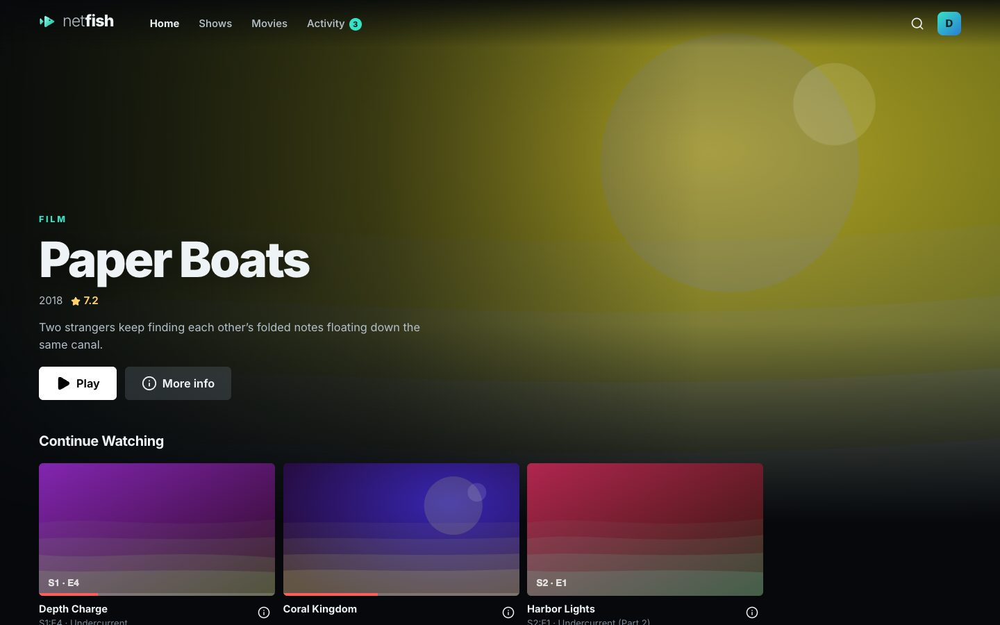

## Contents

- [Features](#features) · [Download](#download) · [Screenshots](#screenshots) · [Install guides](docs/install/README.md) ([italiano](docs/install/it/README.md))
- [How it fits together](#how-it-fits-together) · [What's where](#whats-where)
- [Install on the Pi (Portainer)](#install-on-the-pi-portainer) · [Admin settings](#admin-settings-in-the-app) · [Stack variables](#optional-stack-variables)
- [Playback: who does the work?](#playback-who-does-the-work)
- Apps: [Mac](#mac-app) · [Windows](#windows-app) · [Android, Fire TV, Android TV](#android-app-phones-tablets-fire-tv-android-tv) · [Samsung TV](#samsung-tv-app) · [iPhone & iPad](#iphone--ipad-app)
- [Developing](#developing) · [Building and releasing](#building-the-apps-and-releasing)
- [Good to know](#good-to-know) · [Changelog](CHANGELOG.md) · [Licence](#licence) · [Roadmap](#roadmap)

## Features

### Watching
- **Home like a streaming service:** Continue Watching, *Ready to watch*, *Top picks for you*, *Because you watched…*, new arrivals, trending and coming soon.
- **Discover tab (optional):** an admin can split Home in two. Home then shows only what's in the library, ready to play, and a **Discover** tab after it has everything to request: trending, picks, coming soon and your requests.
- **A real player:** plays the file as it is when it can; otherwise Jellyfin repackages it (cheap on a Pi) and only transcodes as a last resort. Audio and subtitle switching, resume, skip intro, next episode, keyboard shortcuts, and a preview picture as you scrub the timeline (from Jellyfin's trickplay images, see *Good to know*).
- **Your languages, as in Jellyfin:** films start with the audio and subtitles your Jellyfin settings and Jellyfin's memory of each title ask for, the same tracks Jellyfin's own apps pick. Change those settings in **Settings → Playback on this device**; subtitles you pick while watching become your default. A browser or TV can only play a file's main audio track, so when your language is another track, Jellyfin repackages the film with yours (light work: the picture is copied as it is).
- **Play on TV:** connect to the TV (or any device with Netfish open) with the cast button next to your profile picture, like YouTube; then Play plays there and your phone becomes the remote: pause, skip, audio and subtitles. A film you're already watching can be handed over mid-way.
- **Chromecast:** in the Android app on phones and tablets, the player's cast button also lists the Chromecasts on your network. The film carries on there from the same spot, the phone is the remote, and **Stop casting** brings it back.
- **Watch together:** turn what you're watching into a room from the player (or from a title's **⋯** menu). Play, pause, skipping and the next episode stay in step on every device, and the room shows up for everyone on your server right away.
- **Channels:** your library as TV, when an admin turns them on. Each channel plays around the clock and everyone on it sees the same minute; there's no pausing, a short fish-and-net break between programmes with a look at what's next, and a guide up to three days ahead.
- **New on the channels (optional):** Netfish can bring in well-liked films and shows nobody here has for the channels you pick. They're in the guide a week ahead marked *New*, downloaded a few days before they air, and deleted afterwards unless someone presses **Keep**.
- **Mark as watched:** a film, an episode or a whole season; take anything off *Continue Watching* with one click.
- **Offline:** download movies and episodes in the Mac, Windows, iPhone/iPad and Android phone apps, with their subtitles and scrubbing previews. Play then always uses the downloaded copy, and where you stop still counts on the server. When the server can't be reached, the apps switch to offline mode: your downloads first, the rest of your Home greyed out.

### Finding something
- **One search for everything:** your library and all of TMDB. Titles already on the server say **In library**, the rest *Requested*, *On its way* or how far a download has got; the same goes for a director's or actor's films.
- **Directors and actors:** search a name for their films and shows; every name on a title page opens its own page.
- **Suggestions that learn, for free:** TMDB's "people who liked this also liked", blended with each person's favourite genres, directors and actors, plus *Popular on this server*. Runs on the Pi, no subscription.
- **Scores and trailers:** TMDB, IMDb, Rotten Tomatoes, Metacritic and Letterboxd, and trailers in the app.

### Getting it
- **Request in one click:** a movie, or some seasons of a show, filed in Seerr as *you*, so approvals and quotas still apply.
- **Live download progress:** speed and ETA, stalls and import problems explained, and *Not available yet* with the date it should arrive.
- **Versions:** every release from every indexer (Radarr/Sonarr's Interactive Search), filtered by quality, size or **audio language**.
- **Subtitles in any language:** fetched through Bazarr for a movie, a season or one episode.
- **Ready to watch:** a notification when something you asked for arrives.

### For the household
- **Who's watching?:** several people signed in on one device (the living-room TV), switching with a click, each with an optional PIN.
- **Everyone's own:** sign in with your Jellyfin account; progress, requests and suggestions are yours.
- **English and Italian:** every app, server message and guide; Netfish follows your device's language.

### For the admin
- **Set up from the app:** a first-run screen, then **Settings → Connections** for every service, with a test button.
- **Home or Home + Discover:** **Settings → Discover** splits Home into what's in the library (Home) and what to request (Discover).
- **Disk space:** stop or replace downloads, delete a movie or some seasons from disk, see how full each disk is and what could go. Titles deleted from disk stay at the end of Movies and Shows, greyed out under *Not on disk*, ready to download again, with who deleted them and the space freed. That follows Radarr and Sonarr, so it holds wherever a title was deleted. Watched marks are kept for when it's back.
- **Trakt, optional:** one Trakt account for the whole server: history, scrobbling and its recommendations on Home (needs Trakt VIP, see *Good to know*).
- **SuggestArr, optional:** what [SuggestArr](https://github.com/giuseppe99barchetta/SuggestArr) (2.11 or newer) requested from each person's viewing shows on their Home ("Because you watched…") and is marked in Activity; admins see its jobs and can run them now.
- **Download details:** Activity shows each download's custom formats and score, indexer and client from Radarr/Sonarr; admins choose which details everyone else sees.

### Apps
- **Everywhere:** the web app at `http://<pi>:7777` (phones too), plus apps for Mac, Windows, iPhone/iPad, Android (phones, tablets, Fire TV, Android TV) and Samsung TVs.
- **TV mode** (Fire TV, Android TV, Samsung TVs): a big, remote-friendly interface. The arrows move between rows and buttons, the timeline scrubs with left and right (with previews), and Back goes back, asking before it closes Netfish.
- **Up to date by themselves:** the TV and phone apps get new features from the server. When an app itself has something new worth having, Netfish says so on that device, and the Mac, Windows and Android apps (Fire TV too) update in one click; the Mac and Windows apps can also do it on their own with **Auto-update**. Admins see every open device and its version in **Settings → Devices**, and an iPhone installed from a Mac warns before its 7 days run out.

Sign-in uses your Jellyfin accounts. Jellyfin keeps doing the heavy lifting (library, streaming, users) behind the scenes; nobody needs to open it.

## Download

| For | Get it | Step-by-step |
|---|---|---|
| **Server** (Raspberry Pi or any Docker host) | `ghcr.io/ravifrancesco/netfish:latest`, pulled by Portainer | [Server guide](docs/install/server.md) |
| **Mac** (Apple silicon) | [Netfish-mac.dmg](https://github.com/ravifrancesco/netfish/releases/latest/download/Netfish-mac.dmg) | [Mac](docs/install/mac.md) |
| **Windows 10/11** (64-bit) | [Netfish-windows.exe](https://github.com/ravifrancesco/netfish/releases/latest/download/Netfish-windows.exe) | [Windows](docs/install/windows.md) |
| **Android** phones and tablets | [Netfish-android.apk](https://github.com/ravifrancesco/netfish/releases/latest/download/Netfish-android.apk) | [Android](docs/install/android.md) |
| **Fire TV / Fire Stick, Android TV, Google TV** | [Netfish-android.apk](https://github.com/ravifrancesco/netfish/releases/latest/download/Netfish-android.apk) (same app) | [Fire TV & Android TV](docs/install/fire-tv.md) |
| **iPhone & iPad** | [Netfish-ios.ipa](https://github.com/ravifrancesco/netfish/releases/latest/download/Netfish-ios.ipa) (AltStore/SideStore), Xcode, or the browser | [iPhone & iPad](docs/install/iphone-ipad.md) |
| **Samsung TV** (2022 or newer) | [Netfish-samsung.wgt](https://github.com/ravifrancesco/netfish/releases/latest/download/Netfish-samsung.wgt) | [Samsung TV](docs/install/samsung-tv.md) |

Every version is on the [Releases](https://github.com/ravifrancesco/netfish/releases) page; these links always give the newest one. All the guides: [docs/install](docs/install/README.md).
Guide in italiano: [docs/install/it](docs/install/it/README.md).

## Screenshots

| | |
|---|---|
| 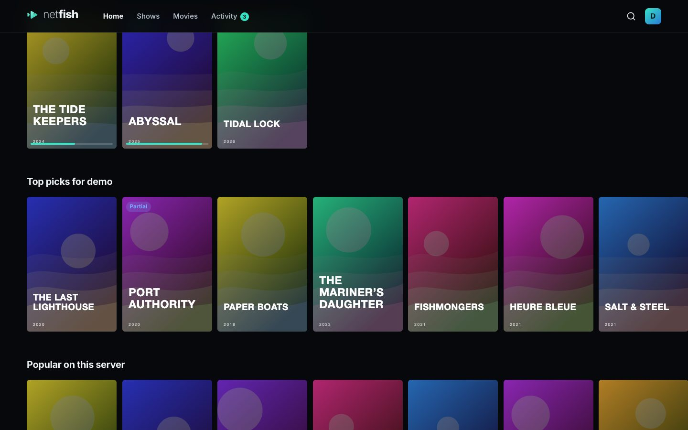 |  |
| Home: rooms to join, Continue Watching, your picks | A film's page: scores, who's watching it together, audio and subtitles |
| 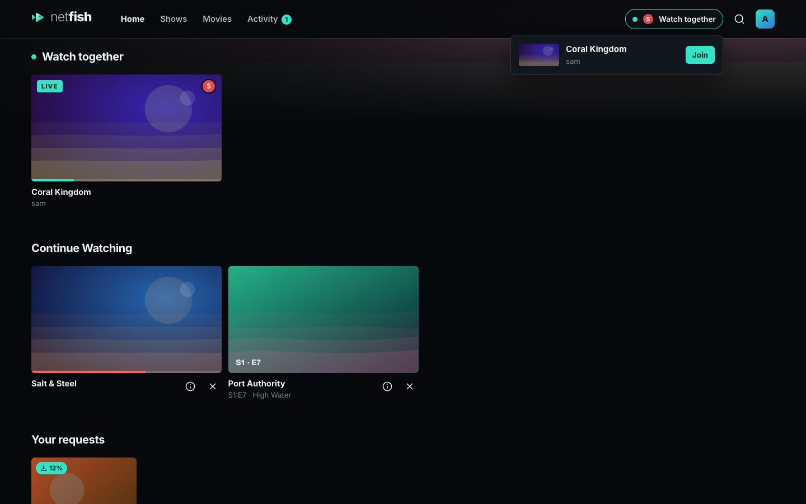 | 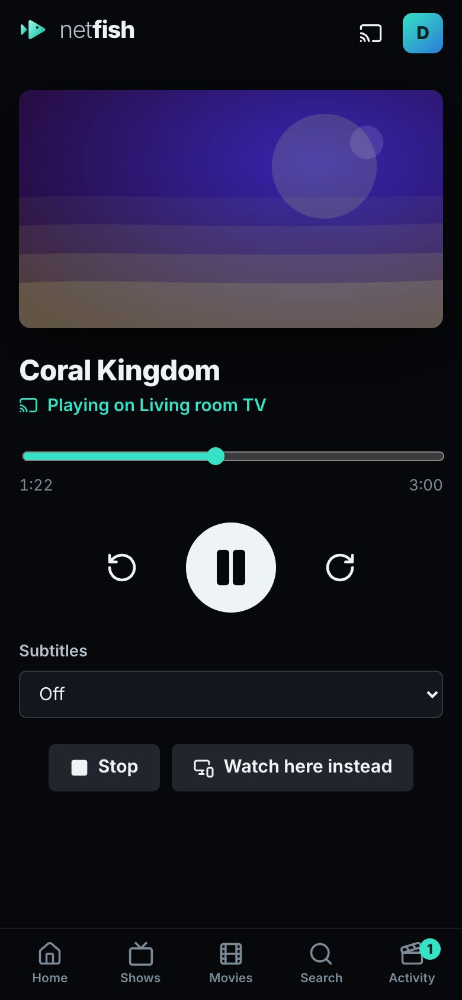 |
| Watch together: rooms show up for everyone, right away | Play on TV: the film plays on the TV, your phone is the remote |
| 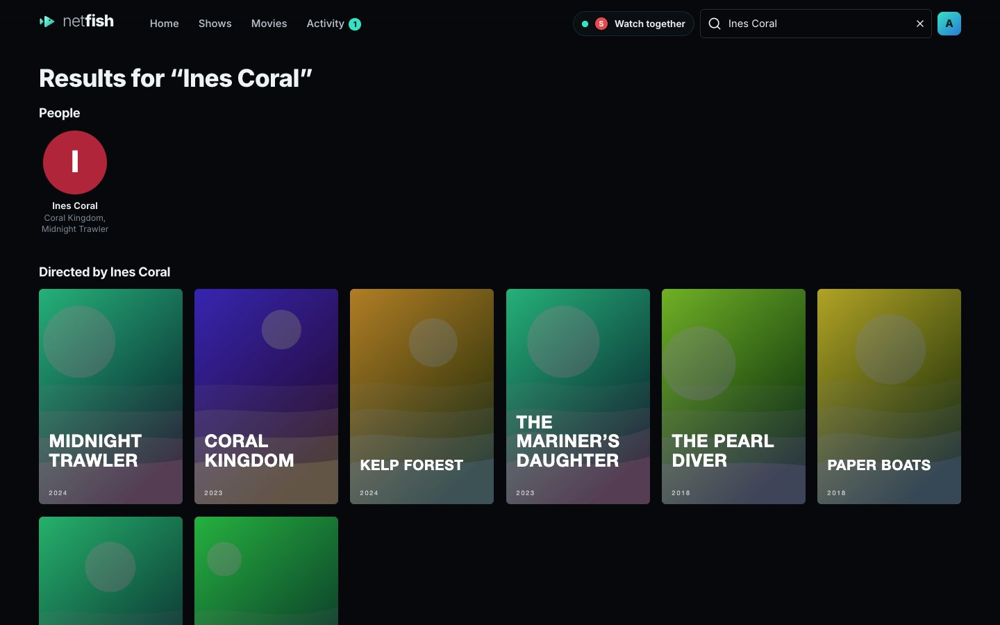 | 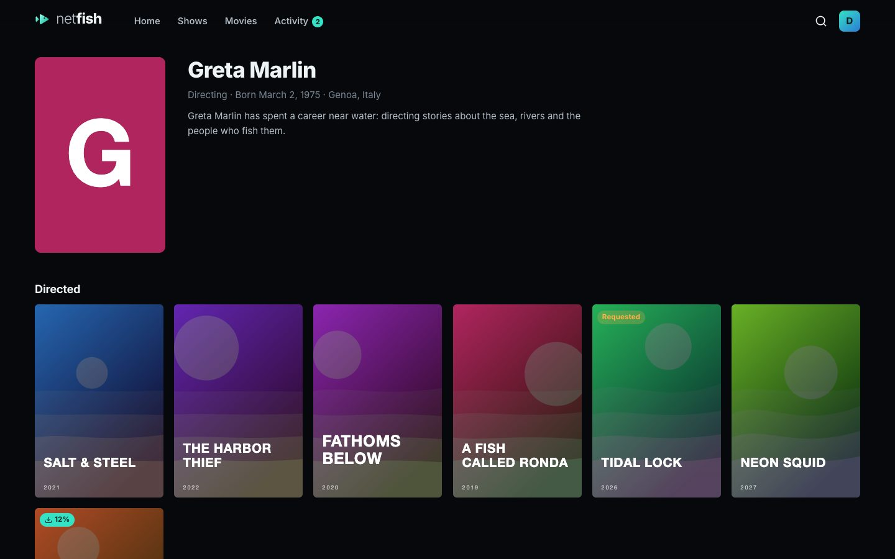 |
| Search a director or actor: their work comes up first | Their page: everything they made, what's in your library first |
| 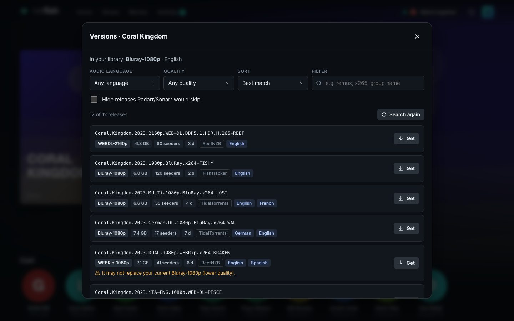 | 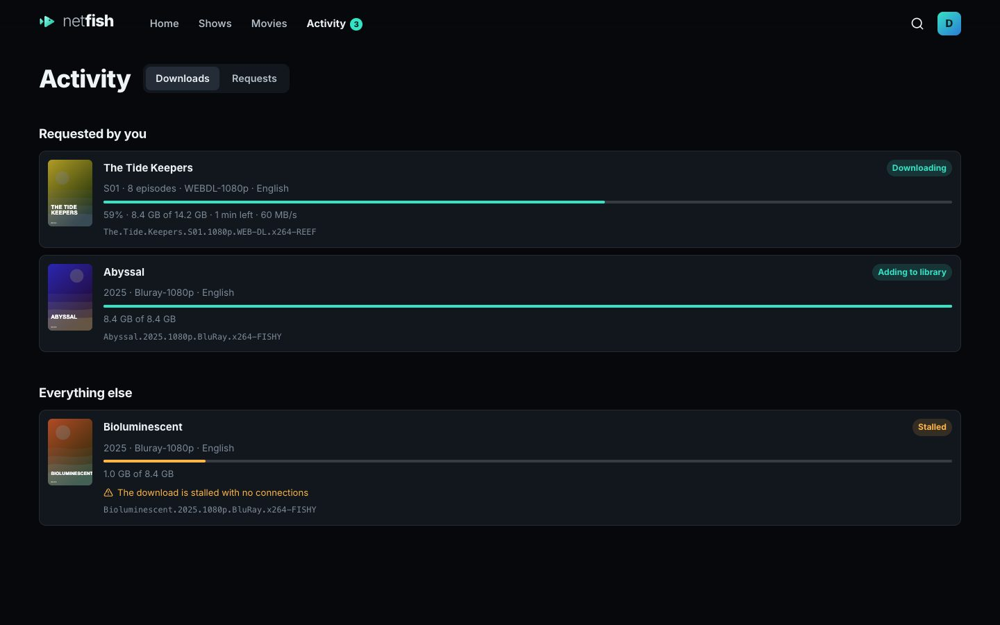 |
| Versions: pick a specific release, filtered by language and quality | Activity: downloads with speed and ETA, stalls explained |
|  | 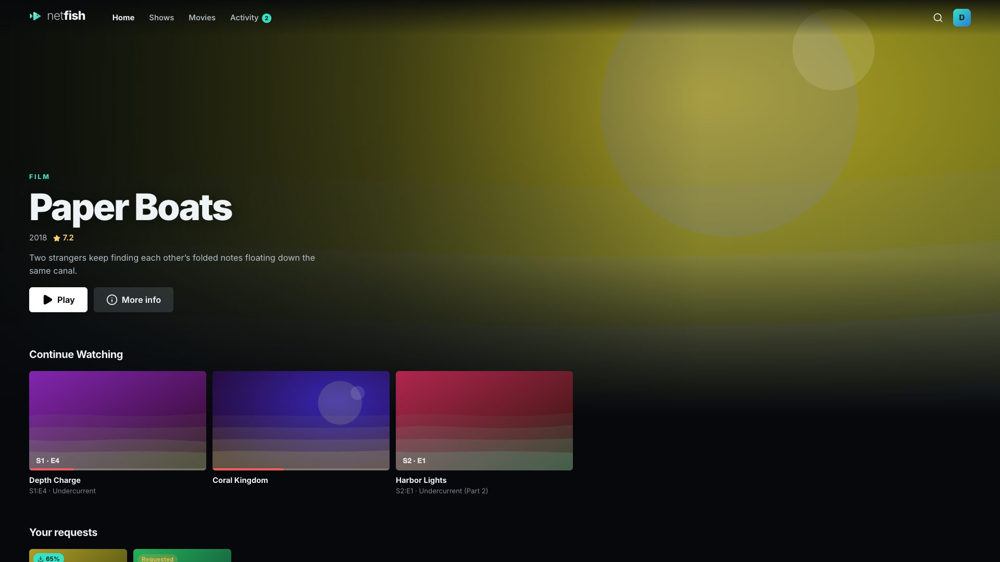 |
| Settings → Connections: every service, with a Test button | TV mode: the remote's arrows, OK and Back |
| 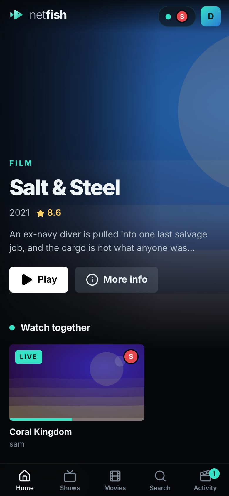 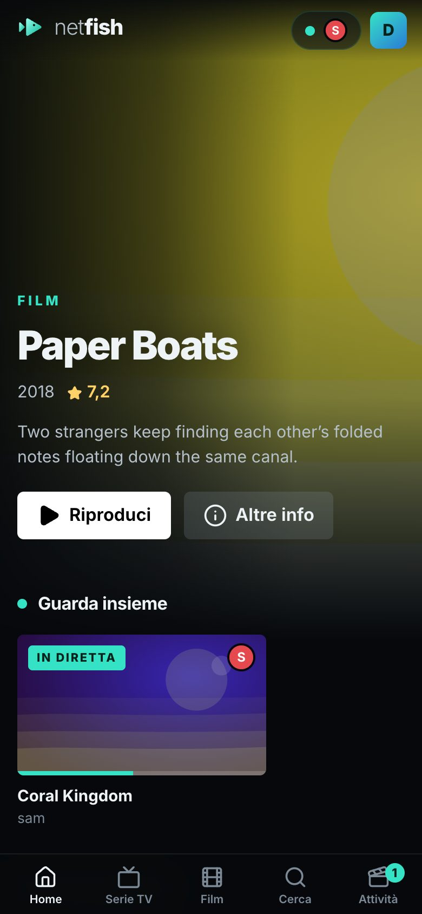 | 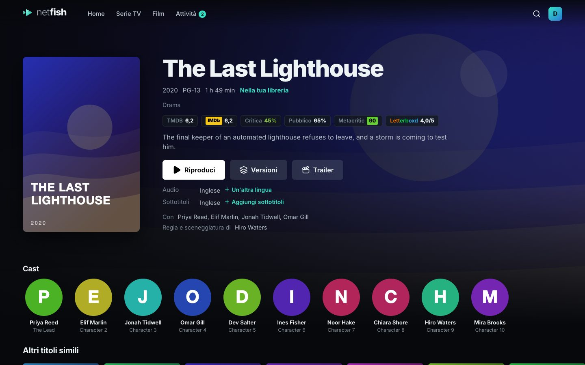 |
| iPhone & Android, in English and Italian | Italian everywhere |

(The pictures use Netfish's built-in test library: made-up films with generated artwork.)

## How it fits together

```
 Browser · Mac · Windows · iPhone/iPad · Android · Fire TV · Samsung TV
                 │  one URL, one login
                 ▼
        ┌──────────────────┐   API keys live here, never in clients
        │  Netfish  :7777  │──────────────┐
        └──────────────────┘              │
          │ streams & images (proxied)    │ JSON APIs
          ▼                               ▼
      Jellyfin              Seerr · Radarr · Sonarr · Bazarr · qBittorrent · (MDBList) · (Trakt) · (SuggestArr)
```

### What's where

| Folder | What it is |
|---|---|
| `server/` | The Netfish server (Node + Fastify), which runs on the Pi. It aggregates the services, holds their API keys, proxies Jellyfin media read-only behind your session, and serves the web app. |
| `web/` | The interface (React + Vite) every app shows. It only talks to the Netfish server, so the engine behind it can change without touching the apps. |
| `shared/` | The API contract (TypeScript types) used by the server and the interface. |
| `apps/mac/` | The Mac app (Swift): the interface on top, mpv playing films underneath. |
| `apps/ios/` | The iPhone & iPad app (Swift). |
| `apps/android/` | The Android app (Java): phones, tablets, Fire TV and Android TV. |
| `apps/windows/` | The Windows app (C#): the interface on top, mpv playing films underneath. |
| `apps/tizen/` | The Samsung TV app (a small starter that opens your server in TV mode). |
| `apps/common/` | The setup page, the downloads page and the icon shared by the apps. |
| `docs/install/` | Step-by-step install guides for every device. |
| `Dockerfile`, `docker/`, `docker-compose.yml` | Running the server on the Pi. |
| `scripts/` | Build helpers. |
| `release/` | **The only place local builds go**: `Netfish-<version>-server.tar.gz` (the Pi image), `-mac.dmg`, `-windows.exe`, `-android.apk`. Not in git; published versions are on GitHub Releases. |

The apps show the interface from your server, so most new features arrive by updating the Pi; the apps themselves rarely change.

## Install on the Pi (Portainer)

**1. Portainer → Stacks → Add stack**, name it `netfish`, paste [`docker-compose.yml`](docker-compose.yml), and **Deploy**. No variables are needed: Portainer pulls the ready-made image `ghcr.io/ravifrancesco/netfish:latest` (built by GitHub for Raspberry Pi and PCs).

**2. Updating:** Portainer → Stacks → netfish → **Update the stack** with **Re-pull image** switched on (or Containers → netfish → **Recreate** with **Pull latest image**). Your settings are kept. To stay on one version, use a version tag instead of `latest`, e.g. `ghcr.io/ravifrancesco/netfish:0.7.16`.

<details>
<summary>Or build the image on the Pi yourself</summary>

Download **Netfish-server.tar.gz** from [Releases](https://github.com/ravifrancesco/netfish/releases) (or make it with `npm run pack:pi`). In Portainer → **Images** → **Build a new image**: name it `netfish:latest`, choose **Upload**, select the file, and click **Build** (a few minutes on a Pi). Then set `NETFISH_IMAGE=netfish:latest` in the stack's environment variables. Repeat for updates.

</details>

**3. Open `http://<pi-ip>:7777`.** Netfish asks for your Jellyfin address: `http://host.docker.internal:8096` if Jellyfin runs on the same Pi. Sign in with a Jellyfin **admin** account, then open **Settings → Connections** and fill in Seerr, Radarr, Sonarr, Bazarr, qBittorrent and (optionally) MDBList, Trakt and SuggestArr. Each has a **Test** button, and changes apply immediately.

If Netfish ever points at the wrong Jellyfin and nobody can sign in, use **Change the Jellyfin address** on the sign-in screen with the *setup code* printed in Netfish's log (Portainer → Containers → netfish → Logs).

### Admin settings in the app

- **Connections:** addresses and API keys of every service, with live status. Keys are stored on the server in a file only Netfish can read and are never sent back to browsers. Stack variables, if you set any, are just starting values.
- **Channels:** turn them on (Netfish starts with a line-up made from the library), then rename, reorder, hide, remove or add channels (a genre, one show in order, the newest films…). **New titles:** pick the channels with ✨, then set the space they may take, how much disk to always leave free, the download hours, a speed limit (needs qBittorrent), how many per channel each week, and how far ahead to download (1 day to a week). They're added to Radarr/Sonarr tagged `netfish-channel`, kept out of everyone's library and Activity in Netfish (Jellyfin's own apps still show them), and never include anything someone requested.
- **Downloads:** who can pick specific versions (everyone or admins), and max release size for movies and per episode. Releases over the limit are hidden in Versions and refused by the server, and season packs count per episode. Admins can still show and pick them. Automatic downloads from requests follow Radarr/Sonarr's own size settings.

Everything is kept in `/docker-data-volumes/netfish-data` on the Pi (change the path in the stack if you keep container data elsewhere), so updates don't lose it. Netfish creates that folder and gives it to `PUID`/`PGID` (1000 by default) on startup.

### Optional stack variables

You can also pre-fill connections from the stack (see [`.env.example`](.env.example)). They appear in the app as "From the stack", and anything saved in the app takes over.

| Variable | Notes |
| --- | --- |
| `NETFISH_IMAGE` | Defaults to `ghcr.io/ravifrancesco/netfish:latest`; `netfish:latest` if you built the image on the Pi. |
| `JELLYFIN_URL`, `JELLYFIN_API_KEY` | API key optional: refreshes items when new subtitles arrive, and lets *Popular on this server* include people who watch in other Jellyfin apps. |
| `SEERR_*`, `RADARR_*`, `SONARR_*`, `BAZARR_*`, `QBITTORRENT_*`, `MDBLIST_API_KEY`, `TRAKT_CLIENT_ID`, `TRAKT_CLIENT_SECRET`, `SUGGESTARR_URL`, `SUGGESTARR_API_KEY` | Same as in Settings → Connections. The Trakt account itself is linked in the app. |
| `MANUAL_GRABS` | Starting value for who may pick versions (`all` / `admin`). |
| `METADATA_LANGUAGE` | Language for TMDB titles and descriptions (`en`, `es`…). |
| `TRUST_PROXY` | `true` behind a reverse proxy. |

## Playback: who does the work?

Your **device** decodes the video (the computer's or phone's GPU), never the Pi. Jellyfin on the Pi does one of three things, and the player shows which:

1. **Direct play:** sends the file untouched. Netfish declares what your device can decode (H.264, HEVC, AV1, VP9; AAC, Opus, FLAC; MP4 and, in Chrome/Edge, MKV; the Mac, Windows and Android apps play nearly everything), so most Radarr/Sonarr downloads play this way.
2. **Repackaged:** rewraps the video untouched. It's used for AC3/DTS audio, which browsers can't play, so only the audio gets converted, which is light work.
3. **Transcoding:** only when your device can't decode the video at all, image-based subtitles must be burned in, or you cap the quality for remote viewing. This is the only case that's heavy on a Pi.

## Mac app

A native Mac app (`apps/mac/`) built the way Jellyfin Media Player works: **mpv plays the film inside the window, underneath Netfish's own interface**, so you get Netfish's player (controls, menus, skip intro, next episode) while mpv decodes everything itself (MKV, DTS/TrueHD/Dolby, picture subtitles, HDR) with the Mac's hardware decoder. The server just sends the file. Audio and subtitle changes are instant.

**Install:** open [Netfish-mac.dmg](https://github.com/ravifrancesco/netfish/releases/latest/download/Netfish-mac.dmg) and drag Netfish to Applications (macOS 15 or later; mpv is inside the app, nothing else to install). The app isn't notarized yet, so the first time allow it in **System Settings → Privacy & Security → Open Anyway** ([Mac guide](docs/install/mac.md)). On first launch, enter your server address (e.g. `192.168.1.50`).

**Volume:** the player's volume is the Mac's own: the volume keys move the player's slider, and the slider moves the Mac's volume.

**Downloads:** the **Download** button, the Offline tabs and the downloads page (⇧⌘D) work as before; files live in `~/Library/Application Support/app.netfish.mac` and are saved as MP4.

Build it yourself: `npm run build:mac` (Xcode command-line tools, and `brew install mpv dylibbundler`: the build copies libmpv and its libraries into the app).

## Windows app

`apps/windows/` is a native Windows app built the same way as the Mac one: **mpv draws the film underneath the Netfish interface** (Edge's WebView2, transparent where the picture shows), like Jellyfin Media Player. mpv decodes with the PC's graphics hardware and plays every format and subtitle itself, so the server just sends the file.

**Install:** run [Netfish-windows.exe](https://github.com/ravifrancesco/netfish/releases/latest/download/Netfish-windows.exe) on the PC (Windows 10 or 11, 64-bit). It installs for your account only, without admin rights, and adds Netfish to the Start menu and desktop. The installer isn't signed yet, so Windows SmartScreen may say *Windows protected your PC*: click **More info → Run anyway**. On first launch, enter your server address (e.g. `192.168.1.50`). Remove it from **Settings → Apps** like any app.

**Downloads:** the **Download** button, the Offline tabs and the downloads page (Ctrl+Shift+D) work like on the Mac. Files are saved **exactly as they are on the server** (mpv plays them all, with every audio and subtitle track), so downloading costs the Pi nothing. They live in `%LOCALAPPDATA%\Netfish\Offline`. Interrupted downloads continue where they stopped.

**Keys:** F11 full screen, Ctrl+Shift+H home, Ctrl+Shift+D downloads, plus the player's own keys. The player's volume is the PC's own, so the volume keys and the slider move together.

Build it yourself, on a Mac or PC: `npm run build:windows`. It needs the .NET 8 SDK and, on a Mac, `brew install makensis sevenzip`. It downloads a pinned libmpv build (shinchiro's, the one mpv.io links to) and checks its checksum.

## Android app (phones, tablets, Fire TV, Android TV)

One app (`apps/android/`) for every Android device (step by step: [Android phones](docs/install/android.md), [Fire TV & Android TV](docs/install/fire-tv.md)). On a **TV** (Fire TV, Android TV) it shows the Netfish interface in **TV mode**: the remote's arrows move between rows and buttons, Select opens or plays, Back closes menus and then goes back; no downloads on TV. On a **phone or tablet** it's the touch interface, with **downloads**: the Download button, Offline tabs and the downloads page work like on the Mac, files are saved as MP4 in the app's storage, and away from home the app opens your downloads.

Films play like on the Mac: **ExoPlayer draws the picture underneath Netfish's own player**, with Jellyfin's FFmpeg audio decoders (the same engine as Jellyfin's Android TV app). The device's hardware decodes the picture and the app decodes any sound format (DTS, TrueHD, Dolby), so the server sends files untouched; ExoPlayer draws every kind of subtitle, picture ones too, and lifts them above the controls when they show. The app tells the server exactly which video formats this device's decoders handle, so only what it truly can't play gets converted. On a phone a film turns to landscape full screen.

**Chromecast** (phones and tablets with Google Play services, app 0.7.13 or newer): while a film plays, the cast button at the top of the player lists the Chromecasts nearby, under any Netfish screens. Pick one and the film continues there from the same spot. The phone is the remote (pause, skip, the timeline, volume, subtitles and audio), and Android's notification has play and pause too. **Stop casting** brings it back to the phone, from where the Chromecast got to. The Chromecast fetches the film from your server itself, with a link that only opens that film and expires after 12 hours, so the server address the app uses must be reachable from the Chromecast (the Pi's LAN address works; `localhost` doesn't). What a Chromecast can't play as it is, Jellyfin converts to H.264 and AAC.

The app is [Netfish-android.apk](https://github.com/ravifrancesco/netfish/releases/latest/download/Netfish-android.apk) (the same file for every device).

**Phone or tablet:** open that link on the phone and tap the downloaded file; Android asks once to allow installing apps from your browser.

**Fire TV, with the Downloader app (no computer needed):**

1. **Settings → My Fire TV → About**: click your device's name seven times until it says you're a developer.
2. **Settings → My Fire TV → Developer Options**: turn on **ADB debugging**, and under **Install unknown apps** allow **Downloader** (install *Downloader* from the Amazon Appstore first).
3. Open Downloader and enter `https://github.com/ravifrancesco/netfish/releases/latest/download/Netfish-android.apk`, then **Install**.
4. Open **Netfish** from Your Apps & Channels and type your server address (just `192.168.1.50` is enough).

**Fire TV, from a computer:** do steps 1–2, find the TV's address in **Settings → My Fire TV → About → Network** (e.g. `192.168.1.60`), then with Android's platform-tools (`brew install --cask android-platform-tools`):

```bash
adb connect 192.168.1.60
adb install -r Netfish-android.apk
```

Accept the "Allow USB debugging?" prompt on the TV the first time. To update later, install the new APK the same way: your sign-in is kept.

Build it yourself: `npm run build:android` (JDK 17+ and the Android SDK; set `sdk.dir` in `apps/android/local.properties`). Try TV mode in any browser with `http://<server>:7777/?tv=1`.

## Samsung TV app

`apps/tizen/` is a small Samsung TV (Tizen) app: it asks for your server's address once, then opens Netfish in **TV mode**, like the Fire TV app: arrows, OK and Back on the remote, with the timeline scrubbing on left and right. Back on Netfish's first page asks before closing it, and on a Full HD or 4K TV everything is drawn about 1.5× bigger. Subtitles are drawn by Netfish itself, since the TV's browser doesn't draw them. The first time a film's subtitles are asked for, Jellyfin has to pull them out of the file, which can take a little while on a Pi. Films play with the **TV's own player**, as in Jellyfin's Samsung app: MKV, HEVC, AV1 (2020+ TVs) and Dolby sound play as-is, so the server just sends the file; DTS and TrueHD sound get converted. Netfish declares exactly this to the server when it detects a Samsung TV, and the web interface is built to run on the TVs' browsers from 2022 (Chromium 85) onwards.

Samsung only installs apps outside its store in Developer Mode, signed for your TV: use the community TizenBrew Installer or Samsung's Tizen Studio, step by step in the [Samsung TV guide](docs/install/samsung-tv.md). Build the package yourself with `npm run build:samsung` (it makes the unsigned `release/Netfish-<version>-samsung.wgt`).

## iPhone & iPad app

`apps/ios/` is a universal app around the same interface, with **downloads**: the Download button, Offline tabs and the downloads page work like on the Mac, files live in the app's private storage, keep downloading in the background, and play without a connection (away from home, the app opens your downloads automatically). Downloads are saved as MP4 (H.264/HEVC) since iPhones don't play MKV; Netfish asks Jellyfin to repackage when needed.

Films play with **Apple's player underneath Netfish's own player** (like the Mac app with mpv), with picture in picture and AirPlay: MP4/MOV, H.264/HEVC and Dolby sound play as-is; MKV files are rewrapped by the server (light work) and DTS/TrueHD sound is converted. Subtitles are drawn by Netfish over the picture.

**Install it on your iPhone/iPad** (all the options, including the browser version and AltStore/SideStore with `Netfish-ios.ipa`, are in the [iPhone & iPad guide](docs/install/iphone-ipad.md)):

1. Install **Xcode** from the Mac App Store and open it once.
2. Open `apps/ios/Netfish.xcodeproj`. Select the **Netfish** target → **Signing & Capabilities** → **Team**: add your Apple ID (Xcode → Settings → Accounts) and pick it. If Xcode says the bundle ID is taken, change `app.netfish.ios` to something of your own, e.g. `com.yourname.netfish`.
3. Plug in the iPhone/iPad (or pick it over Wi-Fi), choose it as the run destination, press **Run** (⌘R). On the device: **Settings → General → VPN & Device Management** → trust your developer certificate. On iOS 16+ also turn on **Settings → Privacy & Security → Developer Mode**.
4. On first launch, allow **Local Network** access, then enter your server address.

With a free Apple ID the app must be re-installed from Xcode every 7 days; a paid Apple Developer account ($99/year) makes it last a year and allows TestFlight. The project is generated from `apps/ios/project.yml` with XcodeGen (`brew install xcodegen && cd apps/ios && xcodegen generate`).

## Developing

```bash
npm install
npm run dev:mock     # fake Jellyfin/Seerr/Radarr/Sonarr/Bazarr/qBit + Netfish + web UI
```

Open http://localhost:5173 and sign in as `demo` / `demo` (or `admin` / `admin`). The mock (`server/dev/mock.ts`) has a small catalog, watch history, requests and downloads that progress in real time and land in the library, plus a generated test video with two audio tracks (needs `ffmpeg`).

Against real services: copy `.env.example` to `server/.env`, swap `host.docker.internal` for your Pi's IP, then run `npm run dev`.

`npm run typecheck`, `npm run build`, and `npm start` (production bundle on :7777).

### Building the apps and releasing

| Command | Makes (in `release/`) | Needs |
|---|---|---|
| `npm run pack:pi` | `-server.tar.gz`, the Pi build bundle | Node 22 |
| `npm run build:mac` | `-mac.dmg` | a Mac with Xcode's command-line tools, `brew install mpv dylibbundler` |
| `npm run build:windows` | `-windows.exe` | .NET 8 SDK, `brew install makensis sevenzip` (works on a Mac) |
| `npm run build:android` | `-android.apk` | JDK 17+, Android SDK (`sdk.dir` in `apps/android/local.properties`) |
| `npm run build:samsung` | `-samsung.wgt` (unsigned) | `zip` |
| `npm run build:ios` | `-ios.ipa` (unsigned, for AltStore/SideStore) | Xcode |

The Android and Windows builds run from a copy in `~/Library/Caches/netfish-build` (newer macOS won't let their tools copy files out of iCloud Drive). Every push to `main` makes GitHub build the server image `ghcr.io/ravifrancesco/netfish:latest`.

**To publish a version:** raise `version` in `package.json` (and `netfishVersion` in `apps/android/app/build.gradle`), turn *Unreleased* in [CHANGELOG.md](CHANGELOG.md) into `## <version> (<date>)` with everything the version brings, commit, then run `scripts/release.sh`. It builds everything, tags `v<version>` (GitHub then builds the image `:<version>`), and creates the GitHub release with all the files under fixed names, so the download links above always point at the newest one. The release page opens with the version's changelog entry; the script stops if there isn't one.

## Good to know

- **Picking a version replaces the file.** Radarr/Sonarr import it over your current copy only if it isn't lower quality. Netfish flags releases that would likely be refused; those can still be imported by hand in Radarr/Sonarr.
- **Raspberry Pi and transcoding:** Netfish asks Jellyfin to direct-play or repackage whenever possible. Burned-in (image) subtitles or very high bitrates force real transcoding, which is slow on a Pi.
- **Popular on this server** shows what the other people on your server watched lately (titles only, never who). Each person counts once they open Netfish; with `JELLYFIN_API_KEY` set, people who watch in other Jellyfin apps count too.
- **Trakt needs VIP.** Since August 2026 Trakt only lets VIP accounts create the API app whose Client ID and secret Netfish needs, and a free account can connect only one outside app. Netfish works the same without Trakt: its own suggestions (*Top picks*, *Because you watched…*) come from TMDB through Seerr.
- **Play on TV** lists your own devices (signed in as you) and every TV on your server, since a TV is usually the household's. The film plays under the profile signed in on that TV. Name each device in **Settings → Playback on this device**. While you're connected, the cast button shows the device's name; pick **This device** to play here again.
- **Watch together** keeps a live connection to the server open while you watch (server-sent events). Behind a reverse proxy that buffers responses, turn buffering off for `/api/together/`; Netfish already tells nginx not to.
- **Scrubbing previews** come from Jellyfin's trickplay pictures (Jellyfin 10.9 or newer). Turn them on per library in Jellyfin's dashboard: **Libraries → ⋮ on the library → Manage library → Trickplay → Enable trickplay image extraction** (and *Extract trickplay images during the library scan* for new titles), then run **Scheduled Tasks → Generate Trickplay Images**. On a Raspberry Pi, tick *Only generate images from key frames* in **Dashboard → Playback → Trickplay**: it's much faster. The first run takes hours for a big library, and titles fill in as it goes. Downloads keep their previews when they were made before downloading.
- **Audio and subtitle settings are Jellyfin's.** **Settings → Playback on this device** shows your Jellyfin audio language, subtitle mode and subtitle language, and changing them there changes them in Jellyfin and its apps too.
- **Letterboxd** has no public API; its score comes from MDBList when a key is set, otherwise Netfish links to the film's page.
- **Artwork cache:** Netfish keeps a copy of every poster it has shown (and fetches library posters ahead of time) in `/config/cache/images`, up to 1 GB by default (`IMAGE_CACHE_MB` to change). Covers load instantly after the first time, and apps keep them too.

## Licence

Netfish is MIT-licensed (see [LICENSE](LICENSE)). The apps include or use other open-source projects under their own licences, notably mpv (GPL) in the Windows app: see [THIRD-PARTY.md](THIRD-PARTY.md).

## Roadmap

- **Phase 2:** Netfish's own playback engine (library straight from Radarr/Sonarr plus ffmpeg) and **Import from Jellyfin** (users, watched state, resume points), so Jellyfin can be retired.
- Muted trailer previews on the home hero; profile pictures and per-user preferences.
