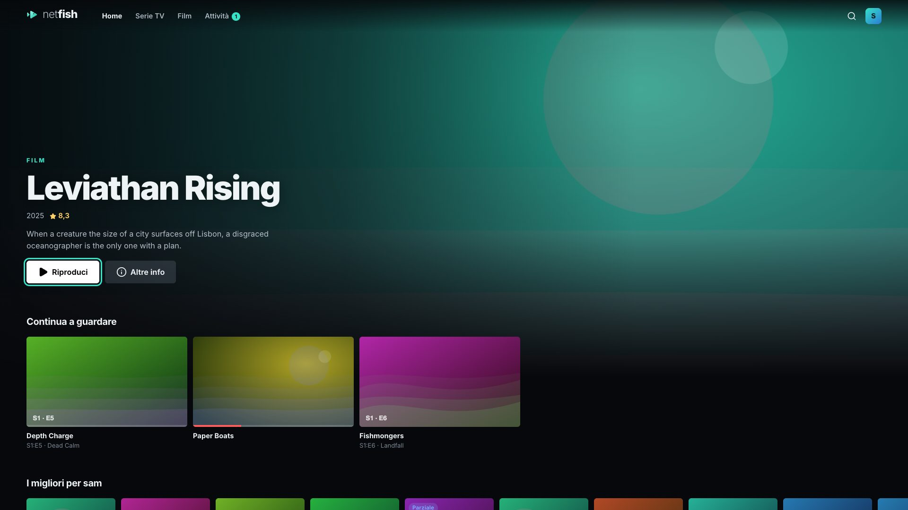

[English](../fire-tv.md)

# Fire TV, Fire Stick, Android TV e Google TV

Un'unica app, **[Netfish-android.apk](https://github.com/ravifrancesco/netfish/releases/latest/download/Netfish-android.apk)**, funziona su ogni dispositivo Android. Sulla TV si apre in modalità TV: con le frecce del telecomando ti sposti tra righe e pulsanti, **OK** apre o riproduce, **Indietro** chiude i menu e torna indietro.

I film si riproducono con ExoPlayer, lo stesso motore dell'app TV di Jellyfin. L'hardware della TV decodifica l'immagine e l'app decodifica ogni formato audio (DTS, TrueHD, Dolby), quindi il server invia i file così come sono.



## Fire TV / Fire Stick (con l'app Downloader, senza computer)

1. **Attiva le opzioni sviluppatore** (basta farlo una volta):
   1. **Impostazioni → La mia Fire TV → Informazioni**.
   2. Seleziona il nome del tuo dispositivo (per esempio *Fire TV Stick 4K*) e premi **OK** sette volte, finché compare *Ora sei uno sviluppatore*. Sulle Fire TV meno recenti *Opzioni sviluppatore* c'è già e puoi saltare questo passaggio.
2. **Impostazioni → La mia Fire TV → Opzioni sviluppatore**:
   - attiva **Debug ADB**;
   - attiva **App di origine sconosciuta**. Sulle versioni più recenti di Fire OS si chiama **Installa app sconosciute**: aprilo e consenti **Downloader** (dopo il passaggio 3).
3. **Installa Downloader:** dalla schermata Home, cerca **Downloader** (icona arancione, di AFTVnews) e installalo. Aprilo e, se te lo chiede, consenti l'accesso ai file.
4. Nella casella dell'indirizzo di Downloader, scrivi:
   ```
   https://github.com/ravifrancesco/netfish/releases/latest/download/Netfish-android.apk
   ```
   Seleziona **Go**. Quando il download è finito, seleziona **Installa**, poi **Apri**.
5. Inserisci l'indirizzo del tuo server (per esempio `192.168.1.50`) e accedi.
6. Ora Netfish si trova in **Le tue app e i tuoi canali**. Per metterlo nella schermata Home, evidenzialo, premi il pulsante **☰ menu** e scegli **Sposta in primo piano**.

Quando Downloader ti propone di eliminare il file scaricato, puoi farlo per risparmiare spazio.

## Android TV / Google TV (Sony, TCL, Philips, Chromecast con Google TV…)

1. **Impostazioni → Sistema → Informazioni**: seleziona **Build del sistema operativo Android TV** (o **Build**) sette volte, finché ti dice che sei uno sviluppatore.
2. Installa **Downloader** dal **Google Play Store** sulla TV.
3. **Impostazioni → App → Sicurezza e limitazioni → Origini sconosciute** (i nomi possono cambiare): consenti **Downloader**.
4. Segui i passaggi 4 e 5 della sezione Fire TV.

## Da un computer (adb)

1. Segui i passaggi 1 e 2 della sezione della tua TV qui sopra.
2. Trova l'indirizzo della TV: **Impostazioni → La mia Fire TV → Informazioni → Rete** (Android TV: Impostazioni → Rete).
3. Installa i platform-tools di Android sul computer (Mac: `brew install --cask android-platform-tools`; Windows: [scaricali qui](https://developer.android.com/tools/releases/platform-tools)), scarica l'APK, poi:
   ```bash
   adb connect 192.168.1.60
   adb install -r Netfish-android.apk
   ```
   La prima volta, sulla TV accetta **Consentire il debug USB?** (spunta *Consenti sempre da questo computer*).

## Come si usa

- **Frecce, OK, Indietro** ovunque; **Riproduci/Pausa** e **⏪ ⏩** nel lettore.
- Quando ci sono i sottotitoli, si spostano sopra i controlli.
- Niente download sulle TV (sono per telefoni e tablet).

## Aggiornare

La maggior parte delle novità arriva tramite il tuo server. Per una nuova versione dell'app, ripeti il passaggio 4 (il link porta sempre alla più recente) e scegli **Installa**: accesso e impostazioni restano.

Se poi il riquadro di Netfish nella schermata Home mostra ancora l'immagine vecchia, riavvia una volta la Fire TV (**Impostazioni → La mia Fire TV → Riavvia**): fino ad allora tiene le immagini delle app.

## Problemi

- **"App non installata":** prima disinstalla le versioni precedenti di Netfish (Impostazioni → Applicazioni → Gestisci applicazioni installate), poi installala di nuovo.
- **Downloader dice che il file non si può aprire:** controlla di aver scritto l'indirizzo esattamente, compreso `https://`.
- **"Impossibile raggiungere …":** prova l'indirizzo in un browser sul telefono e controlla che la TV sia sulla stessa rete del server.
