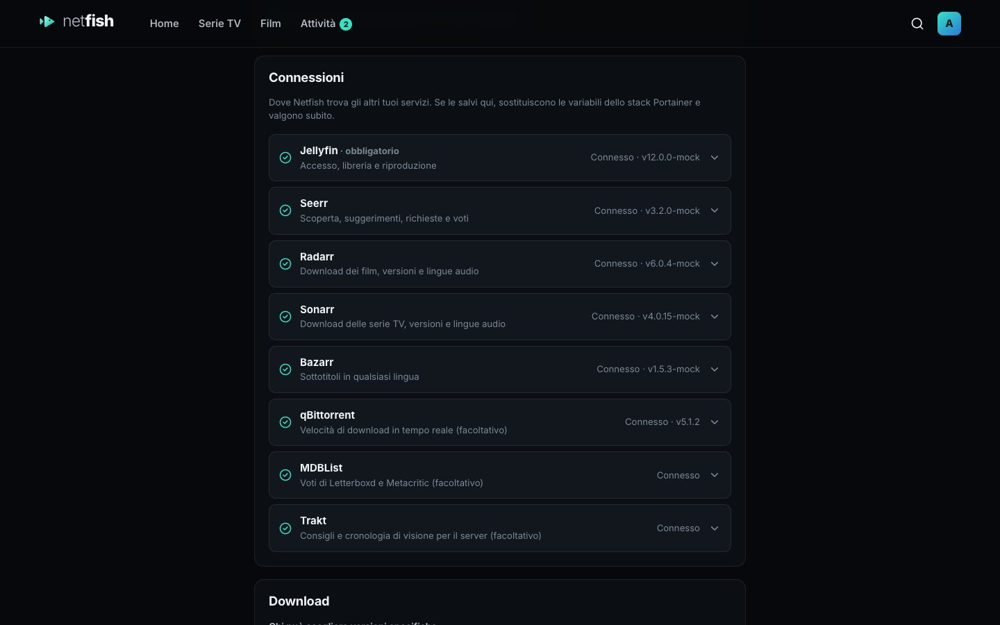

[English](../server.md)

# Server (Raspberry Pi, Portainer)

Il server Netfish gira come un unico container Docker accanto a Jellyfin e agli altri tuoi servizi. Non cambia mai le loro impostazioni: comunica con loro solo tramite le loro API.

**Ti servono:** un Raspberry Pi 4 o 5 con un sistema a **64 bit** (o un qualsiasi PC con Docker), Docker con [Portainer](https://www.portainer.io) e Jellyfin (Seerr, Radarr, Sonarr, Bazarr e qBittorrent sono facoltativi ma consigliati).

L'immagine è `ghcr.io/ravifrancesco/netfish`, creata da GitHub per Raspberry Pi (arm64) e PC (amd64). È pubblica: non servono account né login.

L'interfaccia di Portainer è in inglese, quindi i nomi dei menu qui sotto restano in inglese.

## Nuova installazione

1. Portainer → **Stacks** → **+ Add stack**. Chiamalo `netfish`.
2. Incolla il contenuto di [`docker-compose.yml`](../../../docker-compose.yml) nel **Web editor**.
3. Clicca **Deploy the stack**. Portainer scarica l'immagine (un minuto o due).
4. Apri `http://<your-pi>:7777` in un browser.
5. Netfish ti chiede l'**indirizzo di Jellyfin**: `http://host.docker.internal:8096` se Jellyfin gira sullo stesso Pi, altrimenti il suo indirizzo normale.
6. Accedi con un account Jellyfin **amministratore**.
7. Apri **Impostazioni → Connessioni** e compila Seerr, Radarr, Sonarr, Bazarr, qBittorrent e (se vuoi) MDBList, Trakt e SuggestArr. Ognuno ha un pulsante **Prova**; le modifiche valgono subito.

Tutti gli altri accedono con il proprio account Jellyfin.

Senza Portainer: salva `docker-compose.yml` sul Pi ed esegui `docker compose up -d` in quella cartella.



## Passare uno stack esistente all'immagine di GitHub

Se in passato hai installato Netfish caricando un pacchetto di build (immagine `netfish:latest`):

1. Portainer → **Stacks** → **netfish** → **Editor**.
2. Cambia la riga dell'immagine così:
   ```yaml
   image: ghcr.io/ravifrancesco/netfish:latest
   ```
   Se nella sezione **Environment variables** più in basso c'è `NETFISH_IMAGE`, eliminala.
3. Clicca **Update the stack** con **Re-pull image and redeploy** attivo.

Le tue impostazioni e i tuoi accessi sono salvati in `/docker-data-volumes/netfish-data` sul Pi, quindi restano.

## Aggiornare

Portainer → **Stacks** → **netfish** → **Editor** → **Update the stack**, con **Re-pull image and redeploy** attivo. (Oppure **Containers → netfish → Recreate** con **Pull latest image**.)

Per restare su una versione precisa invece di avere sempre l'ultima, usa un tag di versione: `ghcr.io/ravifrancesco/netfish:0.7.30`. Le versioni sono elencate nella [pagina Releases](https://github.com/ravifrancesco/netfish/releases).

## Creare l'immagine direttamente sul Pi

Per un Pi che non riesce a raggiungere GitHub: scarica **[Netfish-server.tar.gz](https://github.com/ravifrancesco/netfish/releases/latest/download/Netfish-server.tar.gz)**, poi Portainer → **Images** → **Build a new image**: nome `netfish:latest`, carica il file con **Upload**, poi **Build** (qualche minuto). Nello stack, imposta la variabile d'ambiente `NETFISH_IMAGE=netfish:latest`.

## Problemi

- **"no matching manifest for linux/arm/v7":** il Pi usa un sistema a 32 bit. Controlla con `uname -m` sul Pi: Netfish ha bisogno di `aarch64` (Raspberry Pi OS a 64 bit). Usa il metodo "Creare l'immagine direttamente sul Pi" qui sopra, oppure installa il sistema a 64 bit.
- **Porta 7777 già in uso:** cambia il numero a sinistra in `ports:` (per esempio `"7778:7777"`) e usa quella porta nelle app.
- **Netfish non riesce a raggiungere Jellyfin:** dentro il container, `localhost` è il container stesso. Usa `http://host.docker.internal:8096` per i servizi sullo stesso Pi.
- **Indirizzo di Jellyfin sbagliato e nessuno riesce ad accedere:** nella schermata di accesso scegli **Cambia l'indirizzo di Jellyfin** e inserisci il *codice di configurazione* scritto nel log del container (Portainer → Containers → netfish → **Logs**).
