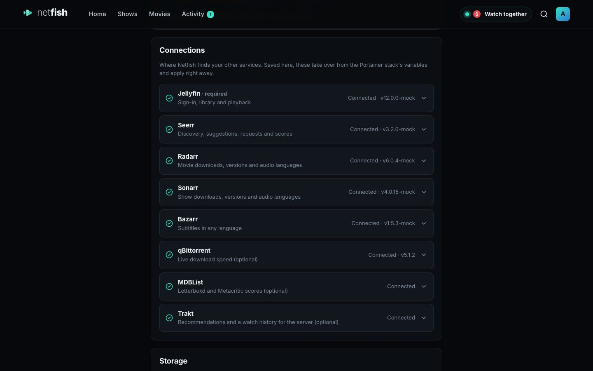

[Italiano](it/server.md)

# Server (Raspberry Pi, Portainer)

The Netfish server runs as one Docker container next to Jellyfin and your other services. It never changes their settings; it only talks to them through their APIs.

**You need:** a Raspberry Pi 4 or 5 with a **64-bit** system (or any PC running Docker), Docker with [Portainer](https://www.portainer.io), and Jellyfin (Seerr, Radarr, Sonarr, Bazarr and qBittorrent are optional but recommended).

The image is `ghcr.io/ravifrancesco/netfish`, built by GitHub for Raspberry Pi (arm64) and PCs (amd64). It's public: no account or login needed.

## New install

1. Portainer → **Stacks** → **+ Add stack**. Name it `netfish`.
2. Paste the contents of [`docker-compose.yml`](../../docker-compose.yml) into the **Web editor**.
3. Click **Deploy the stack**. Portainer downloads the image (a minute or two).
4. Open `http://<your-pi>:7777` in a browser.
5. Netfish asks for your **Jellyfin address**: `http://host.docker.internal:8096` if Jellyfin runs on the same Pi, otherwise its normal address.
6. Sign in with a Jellyfin **administrator** account.
7. Open **Settings → Connections** and fill in Seerr, Radarr, Sonarr, Bazarr, qBittorrent and (optionally) MDBList and Trakt. Each has a **Test** button; changes apply immediately.

Everyone else signs in with their own Jellyfin account.

Without Portainer: save `docker-compose.yml` on the Pi and run `docker compose up -d` in that folder.



## Switching an existing stack to the GitHub image

If you installed Netfish earlier by uploading a build bundle (image `netfish:latest`):

1. Portainer → **Stacks** → **netfish** → **Editor**.
2. Change the image line to:
   ```yaml
   image: ghcr.io/ravifrancesco/netfish:latest
   ```
   If the **Environment variables** section below has `NETFISH_IMAGE`, delete it.
3. Click **Update the stack** with **Re-pull image and redeploy** switched on.

Your settings and sign-ins live in `/docker-data-volumes/netfish-data` on the Pi, so they're kept.

## Updating

Portainer → **Stacks** → **netfish** → **Editor** → **Update the stack**, with **Re-pull image and redeploy** on. (Or **Containers → netfish → Recreate** with **Pull latest image**.)

To stay on a particular version instead of always the newest, use a version tag: `ghcr.io/ravifrancesco/netfish:0.6.3`. The versions are listed on the [Releases page](https://github.com/ravifrancesco/netfish/releases).

## Building the image on the Pi instead

For a Pi without internet access to GitHub: download **[Netfish-server.tar.gz](https://github.com/ravifrancesco/netfish/releases/latest/download/Netfish-server.tar.gz)**, then Portainer → **Images** → **Build a new image**: name `netfish:latest`, **Upload** the file, **Build** (a few minutes). In the stack, set the environment variable `NETFISH_IMAGE=netfish:latest`.

## Problems

- **"no matching manifest for linux/arm/v7":** the Pi runs a 32-bit system. Check with `uname -m` on the Pi: Netfish needs `aarch64` (64-bit Raspberry Pi OS). Use the "build on the Pi" method above, or install the 64-bit system.
- **Port 7777 already in use:** change the left number in `ports:` (e.g. `"7778:7777"`) and use that port in the apps.
- **Netfish can't reach Jellyfin:** inside the container, `localhost` is the container itself. Use `http://host.docker.internal:8096` for services on the same Pi.
- **Wrong Jellyfin address and nobody can sign in:** on the sign-in screen choose **Change the Jellyfin address** and enter the *setup code* printed in the container's log (Portainer → Containers → netfish → **Logs**).
